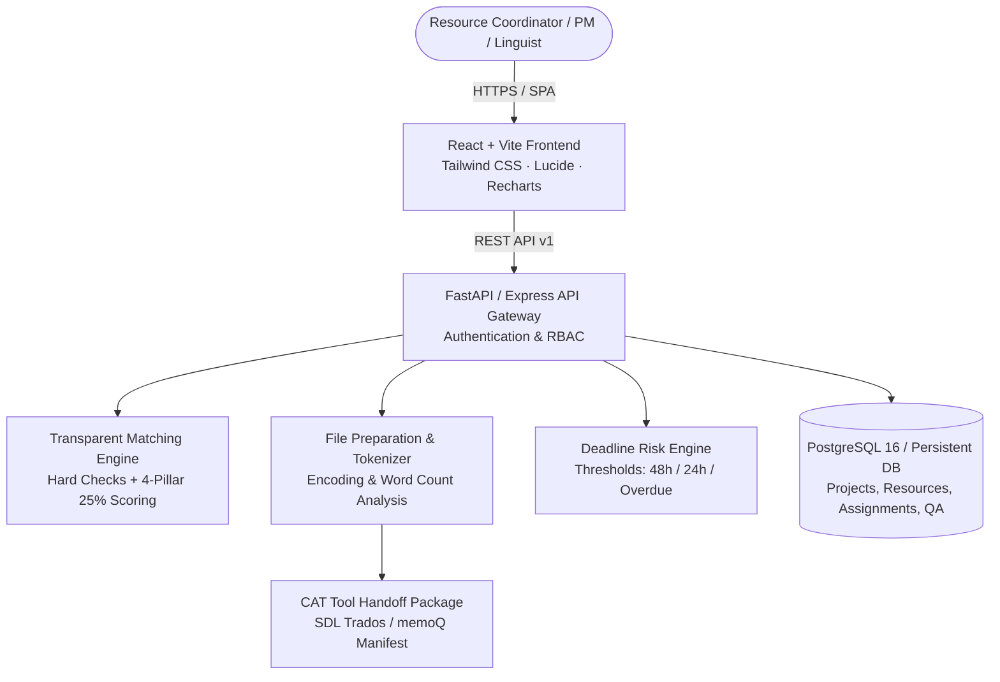
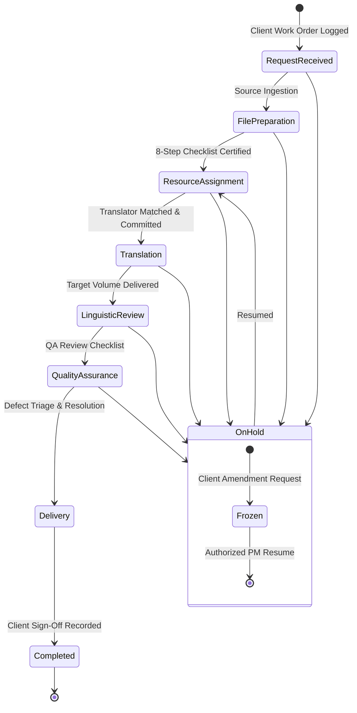

# LinguaFlow — Localization Project & Resource Coordination Platform

> A full-stack localization operations platform for translation project coordination, linguistic resource allocation, source-file preparation, deadline monitoring, and quality assurance.

*Disclaimer: LinguaFlow is an independent portfolio simulation project designed to model the daily operational responsibilities of an Associate Resource Coordinator in the professional translation and localization industry (such as RWS). It is not an official product or affiliate of RWS Group.*

---

## 1. Executive Summary & Business Problem

In global translation and localization operations, Resource Coordinators sit at the heart of delivery. They are responsible for:
- **Intake & Scope Analysis:** Analyzing source packages, verifying encodings, estimating word counts, and confirming customer delivery requirements.
- **Resource Allocation:** Evaluating specialized linguists against strict language pair fluencies, subject-matter expertise (e.g. EMA clinical regulations, automotive telematics, financial market bulletins), availability windows, and capacity limits.
- **Deadline Monitoring:** Mitigating risk before milestones slip, escalating bottlenecked reviews, and rebalancing workloads.
- **Quality Assurance & Compliance:** Administering linguistic review checklists, managing defect resolution, and ensuring terminology compliance.
- **Stakeholder Communication:** Dispatching professional assignment offers, milestone reminders, client updates, and CAT handoff packages.

**LinguaFlow** provides a complete, deterministic, database-backed platform designed specifically for these workflows.

---

## 2. System Architecture



### Key Architectural Highlights
- **Vercel-Ready Frontend:** Single-page React application with client-side routing, optimistic caching via TanStack Query patterns, and centralized API client.
- **Separately Hosted Python API:** FastAPI application in `backend/` with Pydantic validation schemas, SQLAlchemy ORM, Alembic migrations, and automated Pytest test suite.
- **Live In-App Full-Stack Server:** Port 3000 running `server.ts` with Vite dev middleware mode and complete `/api/v1` REST endpoints for interactive preview and verification.
- **Persistent Data Store:** Atomic transactional persistence with realistic seed data (22 projects across all lifecycle stages, 16 verified linguists, 8 enterprise clients, and sample QA issues).

---

## 3. Project Lifecycle Workflow



---

## 4. Transparent Translator Matching Algorithm

The platform uses a deterministic, explainable matching model that never uses black-box scoring:

### 1. Mandatory Hard Eligibility Checks
A candidate is strictly **disqualified** (Score = 0%) if any of the following fail:
1. **Language Pair Coverage:** Must support the exact source and target language pair.
2. **Qualification Verification:** `qualificationStatus` must be `VERIFIED` (pending or expired certifications are blocked).
3. **Availability Status:** Cannot be on sabbatical, leave, or marked `UNAVAILABLE`.

### 2. Weighted 100% Ranking Model
For all eligible candidates, scores are calculated across four 25% pillars:
- **Language Pair Mastery (25%):** Native target speaker awards 25 pts; C2 master proficiency awards 22 pts; C1 awards 18 pts.
- **Subject-Matter SME (25%):** Exact domain match (e.g. `MEDICAL` for clinical trials) awards 25 pts; general technical awards 12 pts; adjacent technical awards 6 pts.
- **Workload Capacity Buffer (25%):** Daily headroom evaluated against the project's daily word volume needed. Ample headroom awards 25 pts; tight capacity buffer awards 8 pts.
- **Historical Quality & SLA (25%):** Calculated from verified QA rating (60% weight) and historical on-time delivery rate (40% weight).

Every candidate card displays a full human-readable explanation of why points were granted or why the specialist was disqualified.

---

## 5. Technology Stack

| Layer | Technologies |
|---|---|
| **Frontend** | React 19, TypeScript, Vite, Tailwind CSS v4, Lucide Icons, Recharts, React Router v7 |
| **Backend (Python)** | Python 3.12, FastAPI, Pydantic v2, SQLAlchemy 2.0, Alembic, Uvicorn, Pytest |
| **Backend (Runtime)** | Node.js 22, Express, tsx, Vite Middleware Engine |
| **Database** | PostgreSQL 16 (production), Persistent JSON Engine (dev container) |
| **Containerization** | Docker, Docker Compose |
| **Deployment Targets** | Vercel (Frontend), Render (FastAPI Backend), Managed Cloud PostgreSQL |

---

## 6. End-to-End Walkthrough Demonstration

To verify the operational responsibilities of an Associate Resource Coordinator:

1. **Dashboard Overview:** Log into `/dashboard` as **Elena Rostova** (Lead Resource Coordinator). Inspect the 10 operational KPI cards, weekly SLA trend, and the coordinator action queue.
2. **Create Translation Project:** Navigate to `/projects/new`. Create a medical project for **Novartis Global LifeSciences** (EN-US to DE-DE, 4,500 words, High priority).
3. **Source-File Analysis & Preparation:** Open the project's **Files & Prep** tab. Upload a sample `.txt` or `.csv` source file. Notice real-time token calculation, UTF-8 validation, and complete the 8-step preparation checklist.
4. **CAT Handoff Manifest:** Click **CAT Handoff Package** to generate and download a manifest compatible with SDL Trados / memoQ.
5. **Run Matching Engine:** Switch to the **Translator Matching** tab. Inspect ranked candidates. Compare **Dr. Sophie Lin** (Top match ~98%) side-by-side with other candidates. Click **Assign Translator**.
6. **Milestone Progression:** Progress the project from `TRANSLATION` to `LINGUISTIC_REVIEW`.
7. **Linguistic QA Defect Resolution:** Open the **Linguistic QA** tab. Log a terminology discrepancy (e.g. non-approved adverse event term). Click **Mark Resolved** and enter corrective TM actions.
8. **Communication Drafting:** Open the **Communication Center** tab. Select the **Final Delivery & Package Confirmation** template. Notice variables (`{projectReference}`, `{wordCount}`, `{clientName}`) auto-populated. Click **Copy to Clipboard**.
9. **Complete Lifecycle:** Mark delivery checklist sign-off and complete the project. Observe updated throughput and on-time delivery rates on the dashboard.

---

## 7. Local Development Setup

### Option A: Standard Full-Stack Development
```bash
# 1. Install frontend dependencies
npm install

# 2. Start the integrated dev server (Port 3000)
npm run dev
```
Open `http://localhost:3000` in your browser.

### Option B: Docker Compose (PostgreSQL + FastAPI + React)
```bash
# Build and run all three services
docker-compose up --build

# Run backend automated pytest suite
docker-compose exec backend pytest tests/
```

---

## 8. Automated Testing

### Backend Unit & Integration Tests (FastAPI / Pytest)
```bash
cd backend
python -m venv venv
source venv/bin/activate
pip install -r requirements.txt
pytest tests/ -v
```
Tests cover:
- Hard eligibility check enforcement
- Transparent scoring weight calculation
- Disqualification reason reporting
- Word count and character count tokenizer rules
- Project lifecycle status validation

### Frontend Linting & Build Verification
```bash
# Verify TypeScript strict type-checking
npm run lint

# Compile production bundle for Vercel
npm run build
```

---

## 9. Deployment Guide

### Vercel (Frontend)
- **Framework Preset:** Vite
- **Root Directory:** `./` (or `frontend/` in split repos)
- **Build Command:** `npm run build`
- **Output Directory:** `dist`
- **Environment Variable:** `VITE_API_BASE_URL` (Points to your deployed FastAPI backend)

### Render / Fly.io (FastAPI Backend)
- **Runtime:** Python 3.12
- **Build Command:** `pip install -r backend/requirements.txt`
- **Start Command:** `uvicorn app.main:app --host 0.0.0.0 --port $PORT`
- **Environment Variables:**
  - `DATABASE_URL`: Connection string to Managed PostgreSQL
  - `SECRET_KEY`: Secure cryptographic key for JWT tokens
  - `FRONTEND_ORIGIN`: Your deployed Vercel domain

---

## 10. Attribution & Limitations

- **Simulated Integrations:** CAT-tool handoff manifests are exported in standard open JSON/TXT formats suitable for ingestion into SDL Trados Studio, memoQ, and Phrase. The platform does not claim to include proprietary Trados DLL packages.
- **Communication Dispatch:** Email notifications use simulated dispatch logging to preserve full audit records without requiring external paid SMTP credentials.
- **Independent Project:** LinguaFlow is an independent engineering portfolio application demonstrating localization project management and resource coordination principles.
